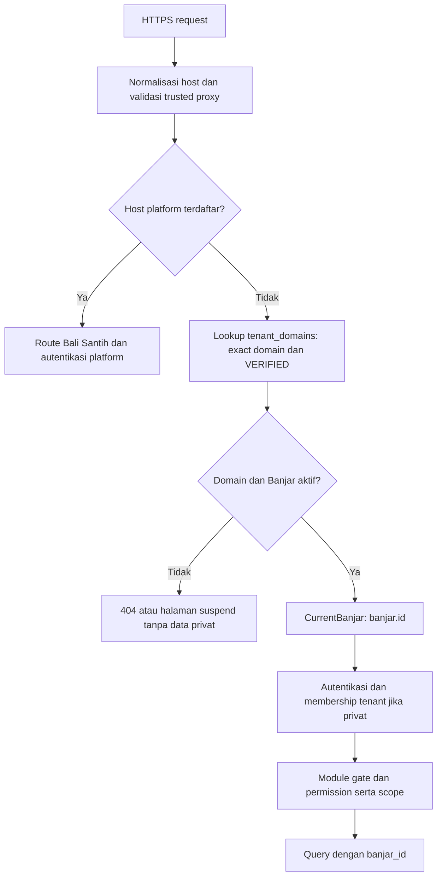
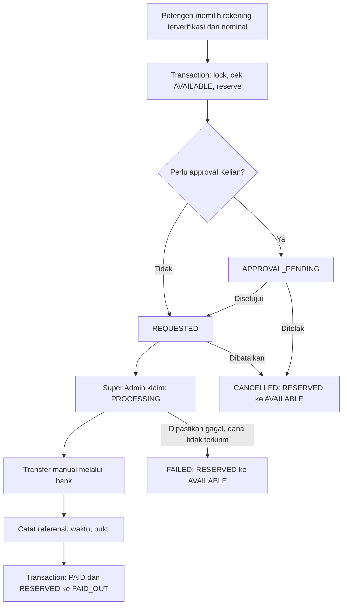

# Banjar Digital V2 — Architecture & Blueprint

Tanggal: 15 September 2026  
Pemilik produk: PT Bali Santih Digital  
Status: Fase 0 selesai; rancangan untuk implementasi bertahap, bukan aplikasi yang sudah berjalan.

**Update 17 September 2026:** Fase 1–10 telah diimplementasikan dan diuji. Lihat [laporan Fase 1](PHASE_1_FOUNDATION.md), [laporan Fase 2](PHASE_2_WEBSITE.md), [laporan Fase 3](PHASE_3_KRAMA.md), [laporan Fase 4](PHASE_4_ADMINISTRATION.md), [laporan Fase 5](PHASE_5_FINANCE.md), [laporan Fase 6](PHASE_6_PAYMENT.md), [laporan Fase 7](PHASE_7_WITHDRAWAL.md), [laporan Fase 8](PHASE_8_ACTIVITY.md), [laporan Fase 9](PHASE_9_ASSET.md), [laporan Fase 10](PHASE_10_PORTAL.md), dan [panduan menjalankan](../README.md). Isi blueprint berikut adalah desain lintas fase; fitur di luar Fase 10 masih rencana.

## 1. Audit dan batas pekerjaan

Repository awal hanya berisi `Master Prompt Codex — Banjar Digital V2 Final.md` (33.388 byte). Belum ada source aplikasi, composer.json, migration, test, konfigurasi deployment, atau repository .git. Tidak ditemukan AGENTS.md pada direktori proyek maupun direktori induk yang diperiksa. Ini adalah greenfield.

Fase 0 menghasilkan blueprint ini saja. Tidak menjalankan migration, memasang Laravel, membuat credential, mengaktifkan pembayaran, atau menerapkan deployment. Test runtime dan pemeriksaan UI belum berlaku karena aplikasi belum tersedia. Fase 1 hanya dimulai setelah instruksi Product Owner, sesuai bagian 62, 63, 67, dan 68 master prompt.

## 2. Keputusan arsitektur

- Satu Laravel 12 modular monolith, PHP 8.2+, MySQL/InnoDB, satu codebase dan deployment untuk semua Banjar.
- Query Builder menjadi akses database utama; Eloquent User boleh digunakan untuk integrasi autentikasi Laravel. Jangan mengandalkan global scope Eloquent untuk keamanan query bisnis.
- Blade dan Tailwind CSS untuk public website, admin, dan portal; Alpine.js hanya untuk interaksi kecil. Semua mobile-first, tanpa SPA atau page builder.
- Satu shared database. `banjar_id` adalah identitas tenant; domain adalah pemetaan yang dapat berubah.
- Controller tipis → Form Request → authorization → application service → tenant repository/Query Builder. Service memiliki transaction boundary dan memanggil modul lain melalui interface/action yang jelas.
- Queue untuk notifikasi, PDF, rekonsiliasi, dan proses besar; scheduler untuk pekerjaan berkala. Efek eksternal dijalankan setelah commit dengan retry dan idempotency.
- Tidak ada automatic payout V1. Semua transfer bank keluar dilakukan manual oleh Bali Santih.

Struktur yang direncanakan:

```text
app/
  Platform/                 # tenant context, domain, identity, audit, module gate
  Modules/
    Website/
    Krama/
    Administration/
    Finance/
    Payment/
    Activity/
    Asset/
    Portal/
    Notification/
  Http/Middleware/
resources/views/{public,admin,platform,portal,components}/
routes/{web,platform,tenant,portal,webhooks}.php
database/{migrations,seeders}/
tests/{Unit,Feature,Integration}/
```

Setiap modul memiliki Services, Queries/Repositories, Policies, Requests, dan Controllers sesuai kebutuhan. Hindari abstraksi generik berlapis sebelum ada kebutuhan nyata. Migrasi tetap terpusat dan diurutkan menurut dependensi.

## 3. Tenant lifecycle dan resolver

Lifecycle: `DRAFT → ACTIVE → SUSPENDED → ARCHIVED`. Onboarding satu transaksi membuat Banjar, domain, konfigurasi template, modul default, akun/membership awal, dan audit. Aktivasi membutuhkan domain siap, profil minimum, dan pengurus awal. Undangan dikirim sesudah commit. Suspend menghentikan akses operasional; webhook dan rekonsiliasi transaksi lama tetap diproses melalui jalur sistem. Arsip tidak menghapus catatan finansial.



Host dinormalisasi lowercase, tanpa port, menggunakan parser host framework; tolak host malformed. Jangan mempercayai forwarded host dari proxy sembarang. Host tak dikenal tidak boleh fallback ke tenant pertama. Host platform berasal dari allowlist konfigurasi, misalnya admin.balisantih.com; namanya direservasi dan tidak bisa didaftarkan sebagai tenant.

`CurrentBanjar` bersifat request/job-scoped, fail closed jika belum terisi. `banjar_id` pada form tidak pernah menjadi sumber context. Repository mensyaratkan context eksplisit dan menambah filter pada read, update, delete, aggregate, export, join, serta lookup relasi. Route parameter diambil melalui query tenant, bukan find global diikuti render. Query Builder tidak otomatis memberi isolasi tenant.

Cache key memakai ID tenant, termasuk halaman publik, permission, dan modul. Job menyimpan banjar_id tepercaya, memuat context ulang, memeriksa status/otorisasi sesuai jenis pekerjaan, dan membersihkan context dalam finally agar worker panjang tidak membawa tenant lama. CLI wajib memilih tenant atau jalur platform eksplisit. File privat memakai prefix tenant dan download terotorisasi; prefix sendiri bukan kontrol akses.

`tenant_domains` mendukung banyak domain untuk satu Banjar. Domain unique global; primary domain menggunakan `banjars.primary_domain_id` yang merujuk domain miliknya, sementara is_primary dapat diturunkan. Jika kolom is_primary dipakai, service menjaga konsistensinya dalam transaksi. Domain alias hanya dialihkan ke primary yang sudah terverifikasi. Custom domain masa depan memerlukan verifikasi kepemilikan DNS dan TLS sebelum VERIFIED. Penghapusan/reassignment domain menginvalidasi cache dan sesi terkait.

DNS wildcard `*.balisantih.com` menunjuk deployment yang sama. Onboarding tenant tidak mengubah source code atau virtual host per Banjar. Root domain dan admin domain dikonfigurasi tersendiri; wildcard certificate tidak mencakup custom domain.

## 4. Batas modul dan feature gate

| Modul | Pemilik data dan aksi | Dependensi |
|---|---|---|
| Platform | Banjar, domain, autentikasi, role, modul, audit | Fondasi |
| WEBSITE | Profil, pengurus publik, konten, media, template, layanan informasi | Platform; membaca agenda Activity |
| KRAMA | KK, individu, unit organisasi, perubahan data | Platform |
| ADMINISTRATION | Pengajuan, verifikasi, approval, PDF, arsip | KRAMA; layanan WEBSITE |
| FINANCE | Kas, billing types/events, bills, dedosan, laporan | KRAMA; kandidat Activity ketika tersedia |
| PAYMENT | Gateway, pembayaran, ledger dana gateway, rekening, withdrawal, rekonsiliasi | FINANCE |
| ACTIVITY | Agenda basic dan kegiatan operasional/presensi | Platform; KRAMA untuk fitur penuh |
| ASSET | Inventaris, pinjam, kondisi, pemeliharaan, disposal | Platform; FINANCE opsional untuk asal perolehan |
| PORTAL | Antarmuka krama, bukan salinan master/bill/kegiatan | KRAMA; modul lain sesuai entitlement |
| NOTIFICATION | Inbox/delivery/web push | Platform; event dari modul aktif |

Ledger dan withdrawal dibangun pada Fase 6–7 di dalam PAYMENT dengan permission tersendiri; kas manual tetap di FINANCE. Saldo kas dan saldo dana gateway tidak digabung tanpa pencatatan yang jelas.

`banjar_modules`: unique (banjar_id, code), status INACTIVE/BASIC/ACTIVE; BASIC hanya sah untuk ACTIVITY. Default WEBSITE ACTIVE, ACTIVITY BASIC, sisanya INACTIVE. ACTIVITY BASIC mengizinkan agenda publik dan pengelolaannya; target peserta, presensi, dan dedosan memerlukan ACTIVE dan KRAMA. Penonaktifan KRAMA ditolak jika dependensi aktif masih memerlukannya. Penonaktifan PAYMENT menghentikan transaksi baru tetapi tidak menghentikan webhook, rekonsiliasi, dan penyelesaian kewajiban lama.

Menu, route middleware, endpoint, dan application service memakai entitlement yang sama. Permission tetap diperiksa terpisah: modul aktif tidak berarti semua pengguna boleh bertindak. Super Admin mengubah aktivasi melalui service yang memvalidasi dependensi dan menulis audit.

## 5. Role, identity, dan akses organisasi

`users` menyimpan identitas login global; `banjar_user_memberships` mengikat user dengan tenant. Role platform terpisah dari role tenant. User dengan dua membership tetap harus login/beroperasi pada domain tenant yang sesuai. Sesi host-only, bukan cookie wildcard bersama semua Banjar; custom domain membutuhkan login pada host tersebut.

| Role standar | Tugas utama | Batas |
|---|---|---|
| Super Admin Bali Santih | Onboarding, modul, status, rekening terverifikasi, antrean payout, audit sistem | Tidak mengedit saldo atau otomatis mendapat akses semua data krama |
| Admin Banjar | Website, konfigurasi dan akun sesuai delegasi | Aksi finansial perlu permission khusus |
| Kelian Adat | Pengesahan dan monitoring | Approval hanya workflow yang mensyaratkan |
| Petengen | Kas, billing, pembayaran dan request withdrawal | Tidak menandai transfer platform PAID |
| Penyarikan | Konten, surat, arsip, notulen | Tidak mengubah ledger |
| Kesinoman | KK, krama, verifikasi perubahan | Scope tenant/unit sesuai assignment |
| Pengurus operasional | Koordinasi/presensi unit | Hanya unit yang ditugaskan |
| Krama | Data dan layanan pribadi/keluarga yang diizinkan | Bukan seluruh data KK atau tenant secara otomatis |

Permission granular: tenant.manage, website.publish, krama.manage, change.verify, change.approve, letter.verify, letter.approve, billing.issue, attendance.verify, dedosan.issue, withdrawal.request, withdrawal.approve, platform.withdrawal.process, platform.withdrawal.mark_paid, bank.verify, audit.view. Role adalah preset permission, bukan pemeriksaan string role di controller.

Scope disimpan pada role assignment: TENANT atau ORGANIZATIONAL_UNIT. Akses turunan unit hanya jika assignment mengizinkan; cegah siklus parent dan parent lintas tenant. Scope diuji pada target object, bukan hanya menu. Akses kepala keluarga terhadap anggota dan tagihan individu harus dibatasi menurut kebijakan privasi yang ditetapkan PO.

## 6. Rencana database dan relationship

Konvensi: PK bigint; identifier publik opaque opsional bukan pengganti authorization. Seluruh tabel milik tenant memiliki banjar_id NOT NULL dan FK ke banjars. Tabel global dikecualikan secara eksplisit. Timestamp disimpan UTC, ditampilkan Asia/Makassar untuk Banjar Bali. Uang IDR disimpan BIGINT rupiah; tidak ada float. Jika gateway mengirim desimal, parse string secara eksak dan tolak pecahan yang tidak didukung. Persentase biaya memakai integer basis point dan aturan pembulatan eksplisit.

Untuk relasi tenant gunakan UNIQUE(banjar_id,id) pada parent dan composite FK (banjar_id,parent_id) pada child. Dengan demikian FK bukan hanya memastikan object ada, tetapi juga tenant cocok. RESTRICT untuk master yang punya histori; finansial tidak cascade delete. Index disesuaikan query dengan prefix banjar_id dan status/tanggal.

Daftar tabel rencana berikut dibangun bertahap, bukan seluruhnya di Fase 1:

| Fase / area | Tabel | Kolom/constraint penting |
|---|---|---|
| 1 Platform | banjars | name, slug, status, primary_domain_id |
| 1 Domain | tenant_domains | banjar_id, domain UNIQUE, verification_status, verified_at |
| 1 Settings | banjar_settings | banjar_id UNIQUE, template_code, accent_color, payout_requires_kelian_approval, settlement_hold_days |
| 1 Modul | banjar_modules | UNIQUE(banjar_id,code), status |
| 1 Identity | users, password_reset_tokens, sessions | Global; password hash, user status; sesi mengikat host/context |
| 1 Membership | banjar_user_memberships | UNIQUE(banjar_id,user_id), status |
| 1 RBAC | roles, permissions, role_permissions, platform_role_assignments | Global catalog; scope role PLATFORM/TENANT |
| 1 RBAC tenant | tenant_role_assignments | banjar_id, membership_id, role_id, scope_type; unit_id ditambahkan Fase 3 |
| 1 Audit | audit_logs | banjar_id nullable hanya aksi platform, actor, action, entity_type/id, old/new, request_id, created_at |
| 1 Runtime | jobs, job_batches, failed_jobs, cache, cache_locks | Infrastruktur global; payload bisnis menyertakan tenant |
| 2 Website | website_profiles, public_officials | Profil 1:1 Banjar; nama/jabatan publik tidak memaksa punya akun |
| 2 Media | media_files | tenant, path, visibility, mime, size, uploader |
| 2 Konten | announcements, news_posts | UNIQUE(banjar_id,slug), title, body, status, published_at; announcement: expires_at, priority, related_activity_id |
| 2 Informasi | service_definitions, public_documents, galleries, gallery_items | Syarat, prosedur, kontak; status publik dan relasi media |
| 2 Activity basic | activities | slug, type, title, start/end, location, status, is_public; detail operasional ditambah Fase 8 |
| 3 Organisasi | organizational_units | parent_id, type, name, is_active |
| 3 KK | households | nomor internal, nomor KK encrypted, status, address, head_krama_id |
| 3 Krama | krama | household_id, user_id nullable, nama, NIK encrypted, status; identitas pencarian exact memakai keyed hash bila diperlukan |
| 3 Scope | household_unit_memberships, krama_unit_memberships | Relasi banyak-ke-banyak, unique pasangan dalam tenant |
| 3 Perubahan | krama_change_requests, krama_change_items | field allowlist, old/new encrypted bila sensitif, requester/verifier/approver dan waktu |
| 4 Surat | letter_requests, letter_request_steps, issued_documents | service_definition_id, krama_id, snapshot identitas, status, nomor dokumen unique per tenant |
| 5 Kas | cash_accounts, cash_transactions | amount integer, direction, reason, reference, reversal_of_id; saldo dihitung dari transaksi |
| 5 Billing | billing_types, billing_events | jenis IURAN/DEDOSAN/OTHER, nominal, event reference, activity_id nullable, status |
| 5 Tagihan | bills | event_id, kk_id, subject_krama_id nullable, gross_amount, status; UNIQUE(banjar_id,billing_event_id,kk_id) |
| 5 Pelunasan | bill_settlements | bill_id, method MANUAL/GATEWAY, payment_id nullable, amount, reference; satu pelunasan penuh aktif per bill |
| 6 Payment | payments | bill_id, order_id UNIQUE, midtrans_transaction_id UNIQUE nullable, gross/gateway_fee/platform_fee/net_amount, method, status, paid_at, settlement_at, available_at |
| 6 Attempts | payment_attempt_locks | UNIQUE(banjar_id,bill_id), active_payment_id; serialisasi pembuatan attempt |
| 6 Webhook | payment_webhook_receipts | payment_id nullable, banjar_id nullable sebelum verifikasi; fingerprint UNIQUE, payload teredaksi, processing status; inbox sistem bukan data publik |
| 6 Ledger | financial_accounts, financial_ledger_transactions, financial_ledger_entries | account UNIQUE(banjar_id,bucket,currency); transaction idempotency_key UNIQUE; entries direction, amount, account_id, transaction_id, reference |
| 6 Rekonsiliasi | reconciliation_runs, reconciliation_items | sumber evidence, mismatch, resolution, actor/timestamp; adjustment memakai approval dan referensi ledger |
| 7 Rekening | banjar_bank_accounts, bank_account_reviews | encrypted number, masked number, holder, status, reviewer; rekening versi immutable setelah dipakai |
| 7 Withdrawal | withdrawals, withdrawal_steps | reference UNIQUE, bank_account_id, snapshot rekening encrypted, amount, status, requested/approved/processed_by dan waktu, bank_reference, proof_media_id |
| 8 Peserta | activity_targets, activity_target_units, activity_target_roles, activity_target_krama | Target relational; ALL_HOUSEHOLDS/ALL_KRAMA atau relasi spesifik |
| 8 Presensi | activity_participants, attendance_records, attendance_reviews | Snapshot target; satu participant per event+KK untuk HOUSEHOLD atau event+krama untuk PERSON |
| 8 Dedosan | dedosan_candidates | activity_id, kk_id, responsible_krama_id, review/approval status; terkait billing event |
| 8 Paruman | meeting_minutes, meeting_decisions, activity_attachments | activity_id; tidak ada event engine kedua |
| 9 Aset | asset_categories, asset_locations, assets | kind INDIVIDUAL/QUANTITY, quantity, condition, status, acquisition_cash_transaction_id nullable |
| 9 Histori aset | asset_movements, asset_loans, asset_loan_items, asset_returns, asset_inspections, asset_maintenance, stock_opnames, stock_opname_items, asset_disposals | Tenant FK, jumlah positif, actor, waktu, alasan; disposal status/histori |
| 11 Notifikasi | notifications, notification_deliveries, push_subscriptions | tenant/user, unique delivery key, opt-in, endpoint privat |

Relasi penting:

```text
Banjar 1—N Domain / Membership / Unit / KK / Content / Activity
KK 1—N Krama; KK.head_krama_id harus anggota KK yang sama
Unit N—N KK/Krama; Unit 1—N child Unit
BillingType 1—N BillingEvent 1—N Bill N—1 KK
Bill 1—N Payment attempts; Bill 0—1 pelunasan penuh aktif
Payment 1—N LedgerTransaction; setiap jenis movement idempotent
LedgerTransaction 1—N LedgerEntry N—1 FinancialAccount
BankAccount 1—N Withdrawal 1—N LedgerTransaction
Activity 1—N Participant / Attendance / Decisions
Asset 1—N Movement / Inspection / LoanItem
```

Head KK diisi setelah individu dibuat, dalam transaksi. Gunakan composite constraint atau validasi terkunci untuk memastikan head dan subject dedosan benar anggota KK tersebut. Nomor KK/NIK tidak dijadikan URL dan tidak disimpan plaintext di audit. Relasi inti tidak disimpan JSON; JSON hanya metadata, snapshot dokumen, audit teredaksi, atau referensi gateway terbatas.

## 7. Website dan pengalaman mobile

Homepage: hero identitas → pengumuman penting → agenda terdekat → layanan → berita → kontak/lokasi. Navigasi publik sederhana: Beranda, Kabar, Agenda, Profil/Layanan; detail pengurus, galeri dan dokumen melalui halaman terkait. Semua konten punya draft/published/archived, scope tenant, dan media visibility.

Pengumuman aktif hanya jika published, published_at <= sekarang, dan expires_at kosong atau masih mendatang. Histori tetap tersedia melalui kebijakan arsip dengan label kedaluwarsa. Slug unik per tenant; permalink pengumuman/berita/kegiatan mempunyai WhatsApp share, canonical primary domain, metadata SEO/Open Graph, dan sitemap hanya konten publik. Share URL dibangun dari domain VERIFIED, bukan Host mentah.

Template berupa curated Blade layouts (Template 01–03), berbagi komponen dan content schema. Accent warna tervalidasi, logo/cover diupload aman, tanpa custom CSS bebas. Fase 2 memprioritaskan satu template siap pakai; variasi tambahan tetap curated. QR website dibuat dari URL primary yang stabil; domain lama dipertahankan sebagai redirect jika diganti agar QR cetak tetap berguna.

Informasi layanan memakai service_definitions yang sama dengan pengajuan surat. CTA Ajukan Sekarang hanya muncul saat ADMINISTRATION dan jalur pemohon tersedia. activities Fase 2 dipakai kembali untuk presensi Fase 8.

Admin: sapaan, CTA Buat Pengumuman, ringkasan agenda/pengumuman/berita; navigasi Beranda, Konten, Kegiatan, Website. Modul lanjutan muncul sesuai role dan aktivasi. Form pendek bertahap, label Indonesia, target sentuh minimal 44px, card pada layar kecil, error dekat input, loading dan empty state jelas. Portal di `/portal` pada host tenant dengan Beranda, Layanan, Aktivitas, Profil. Public controller tidak boleh merender atribut privat kegiatan/krama.

## 8. KK, administrasi, kegiatan, dan aset

Perubahan data: krama mengajukan field allowlist → Kesinoman memverifikasi → Kelian jika policy meminta → service menerapkan perubahan dan audit dalam transaksi. Bandingkan nilai lama/version dengan master saat approval; konflik harus ditinjau ulang, tidak menimpa perubahan terbaru. Request menyimpan old/new, pengaju, verifier, approver, dan timestamp.

Surat: pilih layanan → identitas dari master → data tambahan minimum → Penyarikan verifikasi → Kelian jika perlu → PDF dan arsip. Snapshot saat penerbitan mempertahankan isi surat ketika master berubah; nomor unik, download terotorisasi. Fase 4 menyediakan jalur portal terbatas untuk pengajuan, Fase 10 menyatukan pengalaman portal lengkap.

Kegiatan: union seluruh target menghasilkan snapshot peserta tanpa duplikasi. HOUSEHOLD memiliki satu slot per KK; simpan actual attending_krama_id dan periksa keanggotaan jika perwakilan diizinkan. PERSON satu slot per individu dan tidak dapat diwakili. Status HADIR/IZIN/SAKIT/TIDAK_HADIR/BELUM_DIVERIFIKASI. Perubahan target setelah presensi berjalan perlu audit dan validasi. Ketidakhadiran menghasilkan kandidat setelah verifikasi, bukan tagihan otomatis. Paruman menambahkan agenda, notulen, keputusan, lampiran ke activity yang sama.

Aset INDIVIDUAL memiliki identitas per barang; QUANTITY memakai satu record kelompok dan jumlah. Mutasi/loan/return dikunci dalam transaksi agar stok tidak negatif; jumlah barang dipinjam dibedakan dari tersedia dan rusak. Histori mencakup perolehan, lokasi, kondisi, pinjam/kembali, maintenance, opname, disposal. Kondisi: BAIK, PERLU_PERAWATAN, RUSAK_RINGAN, RUSAK_BERAT, HILANG, TIDAK_DIGUNAKAN. Data nominal/tanggal perolehan ditarik dari pengeluaran terkait jika tersedia. Penghapusan resmi memakai status dan histori, tidak hard delete.

## 9. Billing dan dedosan

Billing Type mendefinisikan kategori, Billing Event mendefinisikan kejadian aktual dan snapshot nominal, Bill melekat pada KK. Iuran memilih Semua KK Aktif atau target kelompok yang didukung; service mengambil snapshot target saat penerbitan, menghasilkan bill dalam batch yang idempotent. Event menjadi ISSUED setelah seluruh batch selesai; retry tidak menggandakan bill.

Database wajib UNIQUE(banjar_id,billing_event_id,kk_id). Contoh event kematian A dan B masing-masing menagih KK-001 Rp25.000, sehingga total Rp50.000 sah. Pengulangan event A tidak membuat tagihan ketiga. Perubahan status/anggota KK tidak memindahkan tagihan lama.

Dedosan menggunakan event type DEDOSAN, subject_krama_id wajib dan harus milik kk_id. Constraint event+KK tetap sama sehingga individu kedua KK tersebut ditolak. Satu kegiatan/jenis dedosan menunjuk satu billing event resmi agar operator tidak menghindari constraint dengan membuat event duplikat. Kandidat presensi → verifikasi → pilih individu → approval jika policy meminta → issue. Dedosan manual sebelum Fase 8 menggunakan event dan alasan eksplisit dengan rule yang sama; tidak berpura-pura berasal dari presensi.

Nominal wajib positif, penerbitan dan void memerlukan permission serta audit. V1 mengasumsikan pembayaran penuh satu bill per attempt; cicilan dan multi-bill checkout memerlukan keputusan lanjutan. Pelunasan tunai/manual dan gateway memakai bill_settlements yang sama agar bill tidak dilunasi dua kali. Koreksi tagihan yang telah dibayar melalui adjustment/workflow, bukan overwrite nominal.

## 10. Midtrans QRIS

Boundary aplikasi: `PaymentGatewayInterface` dengan createQrisPayment, getStatus, verifyNotification; implementasi V1 hanya MidtransPaymentGateway. Server key, client key bila dibutuhkan, merchant configuration, sandbox/production berasal dari environment. Tidak ada endpoint disbursement.

Alur pembuatan:

1. Autentikasi, tenant, PAYMENT active, permission dan kepemilikan tagihan diperiksa server.
2. Lock bill/attempt guard; cek belum lunas, hitung jumlah dari bill, snapshot fee dan buat payment CREATING. order_id opaque global unique, misalnya BD-{ULID}; tidak mengandung NIK atau nomor KK.
3. Commit sebelum network call. Gateway menerima order_id yang sama untuk attempt yang sama. Jangan menahan lock database selama HTTP eksternal.
4. Simpan respons/QR pada payment, ubah PENDING. Timeout masuk UNKNOWN untuk rekonsiliasi; jangan membuat order baru sebelum status order lama dipastikan. Retry aman harus mengikuti kontrak provider, bukan asumsi bahwa charge ulang selalu idempotent.
5. Klien menampilkan QR dan membaca status backend; redirect/JavaScript tidak dapat melunaskan bill.

Webhook pada host platform/jalur khusus: verifikasi signature SHA-512 dari concatenation order_id + status_code + gross_amount + server key, memakai perbandingan constant-time dan representasi string amount asli. Cocokkan order, nominal dan identitas transaksi; tenant diturunkan dari payment tersimpan. Periksa status melalui API server untuk keputusan keberhasilan; kegagalan network dijadwalkan retry. Untuk QRIS hanya status sukses QRIS yang diverifikasi yang diterima; jangan menganggap pending/capture generik sebagai pembayaran QRIS sukses. Rujukan: [Midtrans HTTP notifications](https://docs.midtrans.com/docs/https-notification-webhooks).

Receipt disimpan durable sebelum ACK; retry worker menangani receipt belum selesai. Endpoint mengecualikan CSRF hanya untuk webhook dan membatasi ukuran payload; jalur lain tetap CSRF. Signature invalid ditolak. Fingerprint receipt mengurangi duplikasi tetapi kunci idempotency ledger tetap pertahanan utama. Notification dapat datang tidak berurutan; transisi monotonic mencegah PENDING menurunkan PAID. Rujukan: [Midtrans notification ordering](https://docs.midtrans.com/reference/handle-notifications).

Dalam satu DB transaction dan urutan lock konsisten: lock financial account guard tenant → bill → payment, cek settlement yang sudah ada, update paid_at/status, buat pelunasan, buat ledger credit sekali, tulis audit. Unique order_id, transaction ID, pelunasan bill, dan ledger idempotency key menahan retry bersamaan. Duplicate valid mengembalikan sukses tanpa efek tambahan.

Jika dua attempt ternyata sama-sama dibayar, pembayaran kedua tetap dicatat sebagai dana nyata dan masuk bucket EXCEPTION yang tidak bisa dicairkan; jangan melunaskan bill atau menambah saldo tersedia dua kali. Buat mismatch untuk review/refund manual sesuai policy. Refund/chargeback/amount mismatch tidak boleh diam-diam mengubah saldo; blok availability terkait dan gunakan reversal yang disetujui. Tidak mengotomasi refund dalam blueprint V1.

Rekonsiliasi memeriksa payment lokal ↔ status provider ↔ bill settlement ↔ ledger ↔ evidence settlement bank/provider. Payment pending lama dan UNKNOWN dipoll dengan backoff menggunakan [Get Status API](https://docs.midtrans.com/docs/get-status-api-requests). Webhook `settlement` adalah status transaksi gateway; bukti dana tersedia untuk payout tetap mengikuti policy reconciliation, bukan otomatis disamakan dengan saldo bank yang sudah diterima.

## 11. Ledger immutable dan availability

Gunakan jurnal sederhana berpasangan untuk dana gateway, bukan ERP lengkap. `financial_ledger_transactions` menyimpan type, reference, unique idempotency_key, actor, reason, created_at. `financial_ledger_entries` menyimpan transaction_id, account_id, direction CREDIT/DEBIT, amount positif. Setiap jurnal harus seimbang; saldo bucket = kredit − debit. Counter-account CLEARING menjadi lawan dana masuk; FEE mencatat biaya; EXCEPTION menahan penerimaan bermasalah. PENDING, AVAILABLE, RESERVED, PAID_OUT adalah bucket utama, bukan status entry yang diedit.

Ledger entries hanya insert melalui LedgerService, tidak update/delete. Akun DB runtime dibatasi untuk tabel ledger jika deployment mendukung; admin UI tidak menyediakan edit saldo. Reversal adalah jurnal baru yang merujuk jurnal asli. Snapshot saldo opsional hanya cache yang dapat dibangun ulang, bukan sumber kebenaran.

Contoh gross Rp50.000, gateway fee Rp350 **ilustrasi saja, bukan tarif provider**, platform fee Rp0, net Rp49.650:

| Movement | Debit | Kredit | Kunci idempotency contoh |
|---|---|---|---|
| Payment tervalidasi | CLEARING 50.000 | PENDING 49.650 + FEE 350 | payment:{id}:received |
| Dana lolos availability | PENDING 49.650 | AVAILABLE 49.650 | payment:{id}:available |
| Withdrawal diminta 40.000 | AVAILABLE 40.000 | RESERVED 40.000 | withdrawal:{id}:reserve |
| Transfer manual selesai | RESERVED 40.000 | PAID_OUT 40.000 | withdrawal:{id}:paid |
| Alternatif gagal/batal | RESERVED 40.000 | AVAILABLE 40.000 | withdrawal:{id}:release |

PAID_OUT adalah akumulasi dana yang sudah diteruskan, bukan saldo spendable. Sesudah payout contoh: PENDING 0, AVAILABLE 9.650, RESERVED 0, PAID_OUT 40.000. Jalur paid dan release saling eksklusif untuk satu withdrawal.

`paid_at`: waktu pembayaran terverifikasi. `settlement_at`: waktu settlement dari sumber terverifikasi beserta provenance. `available_at`: paling awal dana boleh dicairkan menurut reconciliation policy. Perhitungan hold memakai konfigurasi tenant/platform `settlement_hold_days`, snapshot policy pada payment, dan basis waktu yang diputuskan PO. Nilai 3 hanya contoh, bukan asumsi aturan Midtrans. Sampai policy/evidence siap, dana tetap PENDING. Fee belum diketahui → tahan availability atau proses adjustment terotorisasi sebelum release; jangan menganggap fee nol tanpa evidence.

Scheduler mengunci account guard dan payment, memeriksa evidence + available_at + status, lalu memindahkan pending→available sekali. Semua penulis ledger mengunci guard yang sama, memakai transaction dan pembacaan saldo current/locking pada MySQL; jangan memakai snapshot saldo lama. Laravel Query Builder menyediakan lockForUpdate: [API Laravel 12](https://api.laravel.com/docs/12.x/Illuminate/Database/Query/Builder.html). Lock order global konsisten account guard → bill/payment atau withdrawal; deadlock retry terbatas dan idempotent.

Invariant: jurnal balance; setiap payment diterima sekali; RESERVED sama dengan total withdrawal nonterminal yang ter-reserve; AVAILABLE tidak negatif; withdrawal PAID memiliki tepat satu jurnal paid; FAILED/CANCELLED memiliki release tepat sekali. Penyesuaian memerlukan reason, actor, timestamp, bukti, dan approval sesuai policy. Saldo tidak diperbaiki dengan SQL edit angka.

## 12. Withdrawal manual V1 dan rekening



Request mengunci guard tenant; hitung AVAILABLE dari ledger authoritative, nominal >0 dan <= saldo; validasi rekening VERIFIED, milik tenant, serta permission Petengen. Simpan reference unique, idempotency key request, snapshot rekening encrypted dan policy approval; reserve dalam transaksi yang sama. Dua request paralel harus terserialisasi. Jika yang pertama memakai saldo, yang kedua melihat saldo terbaru lalu ditolak bila kurang.

Default payout_requires_kelian_approval=false. Jika true, dana tetap RESERVED selama menunggu Kelian. Approval/reject dicatat dengan actor dan waktu; Petengen tidak dapat menyetujui permintaan sendiri lewat permission Kelian yang kebetulan dimiliki, kecuali kebijakan eksplisit di kemudian hari.

Super Admin melihat antrean per tenant, nominal, bank, rekening masked, nama pemilik, status, dan histori. PROCESSING diklaim atomically oleh satu operator untuk mengurangi risiko dua transfer. Operator hanya dapat melihat nomor lengkap untuk kebutuhan transfer melalui akses khusus yang diaudit. Tidak ada API payout otomatis.

Tandai PAID wajib bank_reference, waktu transfer, bukti upload tervalidasi, processed_by/at. Service mengunci guard dan withdrawal, menerima hanya PROCESSING, memvalidasi data dan mencatat RESERVED→PAID_OUT, audit, dan status PAID dalam satu commit. Double-click tidak membuat payout ledger kedua. Bukti disimpan privat sebelum transaksi final; orphan file dibersihkan terjadwal.

Jika bank timeout atau hasil transfer tidak jelas, tetap PROCESSING dan rekonsiliasi; jangan me-release saldo lalu melakukan transfer ulang. FAILED hanya ketika telah dipastikan dana tidak terkirim. Pembatalan otomatis tidak berlaku pada transfer yang sedang diproses. Kegagalan pencatatan setelah transfer manual diperbaiki dengan memasukkan reference transfer yang sama, bukan mentransfer lagi. Reversal setelah PAID merupakan proses koreksi tersendiri dengan evidence, tidak boleh mengubahnya menjadi CANCELLED.

Rekening: Petengen mengajukan versi baru → Super Admin/reviewer memverifikasi → aktif. `account_number_encrypted`, masked, bank code/name, holder, verification_status, primary, reviewer dan timestamps disimpan. Withdrawal memakai versi/snapshot yang dipilih saat request; perubahan rekening tidak mengganti tujuan request lama. Rekening terblokir menghentikan processing untuk review. Tidak ada input rekening baru di form withdrawal. Kunci enkripsi disimpan di secret store dan rotasi punya rencana re-encryption/backup.

## 13. Security dan risiko prioritas

| Risiko | Kontrol wajib |
|---|---|
| Query tanpa scope, IDOR, relasi lintas tenant | Context fail closed, composite FK, scoped repository, policy object, test dua tenant pada semua jalur |
| Host spoofing dan tenant cache bocor | Domain exact match VERIFIED, proxy allowlist, cache prefix tenant, worker context reset |
| Role platform bercampur tenant | Route/guard/permission terpisah, membership aktif, least privilege, audit akses sensitif |
| CSRF/session takeover | CSRF, cookie Secure HttpOnly SameSite, host-only, session regeneration, logout invalidation, rate limit login/reset |
| Webhook palsu/replay/out-of-order | Signature + status server, nominal/order matching, durable inbox, state machine, unique ledger key |
| Double withdrawal/race | MySQL transaction, guard row lock, current balance read, consistent lock order, concurrency tests |
| Transfer manual ganda | Claim operator, state transition atomik, bukti/reference, hasil ambigu tetap PROCESSING |
| Upload berbahaya/XSS | MIME dan ukuran allowlist, nama acak, no executable uploads, raster logo atau SVG tersanitasi, escaped Blade, sanitasi rich text |
| PII/rekening bocor | Encrypted fields dan backups, private files, masked UI/log, signed URL singkat + authorization, audit teredaksi |
| PWA/shared cache membocorkan data | Cache static allowlist; private no-store; jangan cache auth, portal, payment, API, atau dokumen privat |
| Koreksi saldo tanpa jejak | Immutable ledger, adjustment/reversal workflow dan approval, daily reconciliation |

Endpoint sensitif memiliki rate limit berdasarkan user/tenant/IP yang relevan. Super Admin dan aksi finansial memakai autentikasi kuat; MFA direncanakan untuk akun berisiko tinggi sebelum production. Input URL peta/konten dibatasi protokol HTTPS dan provider/embed allowlist; jangan membuat fetch URL bebas yang membuka SSRF. Log tidak menyimpan server key, token, QR credential, NIK, rekening lengkap, atau payload mentah tanpa redaksi. Audit append-only mencatat actor nyata dan sistem secara berbeda.

## 14. PWA dan notification

Manifest tenant-aware berisi nama, warna, start_url dan scope same-origin, icon 192/512 dan maskable. Admin/portal tetap pada origin tenant yang sama. Service worker hanya cache static assets versi tertentu dan offline fallback publik generik; navigasi menggunakan network dan fallback tanpa menyimpan HTML privat. Jangan cache POST, login, session, QRIS, profil keluarga, atau signed download. Clear cache versi lama pada activate; uji logout dan pergantian user pada perangkat yang sama.

NOTIFICATION aktif membuka opt-in web push per user/tenant. Payload lock screen generik tanpa identitas/tagihan sensitif. Delivery memakai idempotency key, job retry/backoff, dan cleanup subscription expired. Website tetap berguna tanpa push; WhatsApp share selalu merupakan share oleh pengguna, bukan pengiriman massal otomatis.

## 15. Mandatory test plan

Gunakan Unit untuk aturan murni; Feature untuk route/service dan authorization; Integration pada MySQL/InnoDB untuk FK, unique constraint, transaction, dan concurrency. SQLite tidak menjadi bukti lolos locking finansial. Gateway dipalsukan pada test deterministik; sandbox contract test terpisah menggunakan secret environment, tanpa transaksi produksi.

| Area | Skenario wajib dan hasil yang diterima |
|---|---|
| Tenant | User A membaca/mengubah ID B melalui route/form/query/export/file/job → 403/404 tanpa data B; FK relasi lintas tenant gagal |
| Domain | Host A→A; alias terverifikasi→tenant sama; unknown/unverified/admin spoof ditolak; worker A lalu B tidak membawa context lama |
| Modul | INACTIVE menolak URL/action langsung; BASIC menolak presensi; job pengguna tidak melewati gate; webhook lama tetap diselesaikan |
| Auth | Role tanpa permission tidak approve surat/dedosan/withdrawal; operational scope menolak unit di luar assignment |
| Website | Draft/future tidak publik, expired tidak aktif, private attachment tertolak, slug tenant terpisah, template escaping aman |
| KK | Head dan subject harus anggota KK; perubahan master memicu konflik approval request lama; NIK tidak bocor di log |
| Iuran | Generate event sama dua kali/concurrent → satu bill per KK; event A dan B → dua bill yang sah |
| Dedosan | Dua anggota KK sama/event sama → penerbitan kedua gagal; event berbeda sah; absen saja tidak membuat bill |
| Payment | Signature salah, amount mismatch, order unknown ditolak; webhook duplicate/out-of-order menghasilkan satu settlement dan satu credit |
| Payment race | Callback tiba sebelum respons charge, timeout create, dua attempt dibayar, manual payment beradu webhook → tidak ada double pelunasan/available credit |
| Ledger | Setiap jurnal seimbang; credit sekali; scheduler availability duplicate aman; PENDING tidak withdrawable; adjustment mempunyai provenance |
| Withdrawal | Nol/negatif/melebihi saldo/rekening belum VERIFIED → gagal tanpa movement; optional Kelian on/off sesuai policy |
| Concurrency | Dua koneksi/proses MySQL dengan barrier pada saldo 100.000, masing-masing request 80.000 → tepat satu berhasil, AVAILABLE 20.000 dan RESERVED 80.000 |
| Withdrawal terminal | Double PAID satu jurnal; FAILED/CANCELLED release sekali; racing paid/cancel hanya satu terminal; hasil transfer ambigu tetap RESERVED |
| Rekening | Ganti rekening setelah request tidak mengubah snapshot; akses nomor lengkap terbatas dan diaudit |
| Kegiatan | Target tumpang tindih dideduplikasi, household representative valid, PERSON tidak bisa diwakili, review dedosan wajib |
| Aset | Loan paralel tidak melebihi quantity, return tidak melebihi pinjaman, disposal menyimpan histori |
| Mobile/PWA | Viewport 360/390/768/desktop, keyboard/focus/contrast, touch target, tidak overflow; offline login/portal tidak menunjukkan data user lama |
| Recovery | Restore backup staging, retry job/webhook pasca crash, rekonsiliasi mismatch tanpa edit saldo, satu scheduler tidak menggandakan movement |

Setiap fase menjalankan test terkait dan regresi fondasi tenant/permission. Fase finansial wajib melewati MySQL tests sebelum dianggap selesai. CI nantinya menjalankan lint/format, test, build assets dan dependency checks. Fase 0 hanya memverifikasi cakupan dokumen terhadap master prompt; belum ada test aplikasi yang dapat dijalankan.

## 16. Deployment assumptions

- Target server Linux dengan Nginx/Apache, PHP-FPM 8.2+ yang kompatibel Laravel 12, Composer, Node untuk build Tailwind, MySQL/InnoDB; versi aktual diverifikasi pada Fase 1. Laravel tetap 12 sesuai master prompt; evaluasi dukungan keamanan sebelum produksi menjadi keputusan eksplisit, bukan upgrade diam-diam.
- Satu artifact deployment melayani wildcard tenant, admin domain, dan webhook host. DNS/TLS production belum tersedia dan tidak dibuat di Fase 0.
- Local Laragon memakai domain development seperti admin.banjar.test dan biaung.banjar.test melalui DNS/hosts lokal; HTTPS lokal dibutuhkan untuk uji PWA representatif. Ini usulan, bukan konfigurasi yang sudah dipasang.
- Database, queue worker, scheduler, dan file storage adalah service deployment yang sama secara logis. Database queue cukup awal; Redis opsional jika beban membutuhkannya.
- Web root hanya public/, APP_DEBUG=false produksi, secrets bukan di Git, strict proxy config, session host-only, URL dibangun dari tenant_domains.
- Scheduler satu pemicu dengan lock; worker restart setelah deploy dan membersihkan tenant context. Migrasi bertahap backward-compatible, backup sebelum migration berisiko, rollback aplikasi tidak menghapus ledger.
- Storage privat terpisah public media, backup terenkripsi dan restore drill. RPO/RTO, retention log/audit/PII serta lokasi penyimpanan diputuskan PO/operasional.
- Monitoring untuk webhook failures, queue age, pending payment lama, reconciliation mismatch, withdrawal PROCESSING lama, exception ledger, error rate dan backup failure. Alert tidak memuat PII.
- Akses Midtrans sandbox dan production, metode settlement evidence, serta kemampuan operasional transfer manual harus siap sebelum PAYMENT diaktifkan. Biaya/settlement tidak diasumsikan dari contoh blueprint.

## 17. Roadmap dan gerbang fase

| Fase | Implementasi dan migration | Gerbang selesai |
|---|---|---|
| 1 Platform foundation | Laravel, tabel platform/identity/domain/RBAC/modules/audit, PWA dasar, mobile admin shell | Resolver, isolation, login, permission dan gate teruji |
| 2 Website Banjar | Profil/pengurus/konten/media/layanan/dokumen/galeri, activities basic, template, QR/WhatsApp/SEO | Website tenant dapat dipakai, publik/privat terpisah dan mobile lolos |
| 3 KK dan krama | Households, krama, organizational units/memberships, scope role, change requests | KK/head valid, unit scope dan perubahan teruji |
| 4 Administrasi | Letter requests/steps/issued documents, PDF, portal pengajuan terbatas | Prefill, verifikasi, approval, private archive teruji |
| 5 Keuangan | Kas, billing types/events/bills/settlements, dedosan, laporan | Rule event+KK, uang integer dan otorisasi lolos |
| 6 Midtrans + ledger | Payments, attempt guard, inbox webhook, accounts/journals/entries, reconciliation | Webhook idempotent, ledger balance, availability teruji; tanpa payout API |
| 7 Withdrawal manual | Bank accounts/reviews, withdrawals/steps dan bukti | Reserve/release/paid atomic, race test MySQL, rekening snapshot lolos — **selesai lokal, lihat docs/PHASE_7_WITHDRAWAL.md** |
| 8 Kegiatan/presensi | Upgrade activities; targets/participants/attendance/candidates/minutes | Entity lama dipakai ulang, target dedup, dedosan melalui review — **selesai lokal, lihat docs/PHASE_8_ACTIVITY.md** |
| 9 Aset | Inventory/loan/return/inspection/maintenance/opname/disposal | Quantity invariant dan histori tanpa destructive delete — **selesai lokal, lihat docs/PHASE_9_ASSET.md** |
| 10 Portal krama | Satukan halaman keluarga, layanan, aktivitas, billing/QRIS/history/profil; migration hanya jika gap ditemukan | Kepemilikan data dan mobile/PWA teruji — **selesai lokal, lihat docs/PHASE_10_PORTAL.md** |
| 11 Dashboard/notification | Dashboard per peran, notifications/deliveries/push subscriptions | Tindakan relevan sesuai scope dan delivery idempotent |
| 12 Production hardening | Audit keamanan, concurrency/reconciliation, DNS/TLS, backup, monitoring, runbooks | Bukti semua test kritis, restore drill dan kesiapan operasional |

Setiap fase: baca blueprint → audit existing → rencana singkat/migration → implementasi → test/perbaikan → mobile review → dokumentasi → laporan. Jangan mengulang fitur fase sebelumnya. Jangan lanjut ke fase berikutnya tanpa instruksi. Tahap implementasi tidak mengubah business rules secara diam-diam.

## 18. Keputusan Product Owner yang masih terbuka

Keputusan ini tidak menghalangi penyelesaian Fase 0. Sebelum fitur terkait diaktifkan, catat keputusan dan tanggalnya:

1. Nama/domain pilot, domain platform, pemegang akses DNS/TLS, dan konten awal Banjar.
2. Template pertama, identitas Bali Santih, aturan publikasi pengurus/foto/dokumen.
3. Field minimum KK/krama; apakah NIK/nomor KK benar diperlukan; akses anggota keluarga, retensi, dan proses koreksi/arsip.
4. Scope unit turunan, kombinasi role, kebutuhan approval Kelian untuk perubahan data/surat/dedosan. Withdrawal default tanpa approval Kelian sesuai master prompt.
5. Akun merchant Midtrans, QRIS diaktifkan, sumber settlement/reconciliation evidence, tarif gateway, pembulatan, dasar hold (hari kalender atau kerja), dan durasi hold. Platform fee tetap 0.
6. Kebijakan pembayaran ganda, refund, chargeback, biaya yang berubah, dan mismatch settlement; siapa reviewer serta approver adjustment.
7. Verifikator rekening, dokumen bukti kepemilikan, batas/minimum withdrawal, biaya transfer, jam layanan/SLA dan operator transfer manual. Tanpa kebijakan biaya baru, jangan memotong saldo secara implisit.
8. Apakah identitas krama boleh mengakses beberapa Banjar dan hak kepala keluarga atas tagihan dedosan anggota; skema autentikasi krama yang realistis.
9. RPO/RTO backup, retensi audit/PII, kanal alert dan dukungan operasional.
10. Jadwal go-live serta konfirmasi versi runtime dan dukungan keamanan Laravel 12 sebelum produksi.

## 19. Verifikasi cakupan Fase 0

- Architecture, lifecycle, tenant flow/domain/isolation: bagian 2–3.
- Module boundaries dan Super Admin: bagian 4–5, 12.
- Tabel, relationship, constraint dan migration roadmap: bagian 6, 17.
- Website, activity reuse, role/unit, administrasi, assets: bagian 5, 7–8.
- Billing, Midtrans, immutable ledger dan manual withdrawal: bagian 9–12.
- Security, PWA, mandatory tests, deployment dan keputusan PO: bagian 13–18.
- Tidak ada source aplikasi atau migration yang diimplementasikan pada Fase 0.

**Catatan gerbang:** instruksi Fase 1–10 telah diberikan dan implementasinya selesai. Fase 11 menunggu instruksi Product Owner berikutnya.
